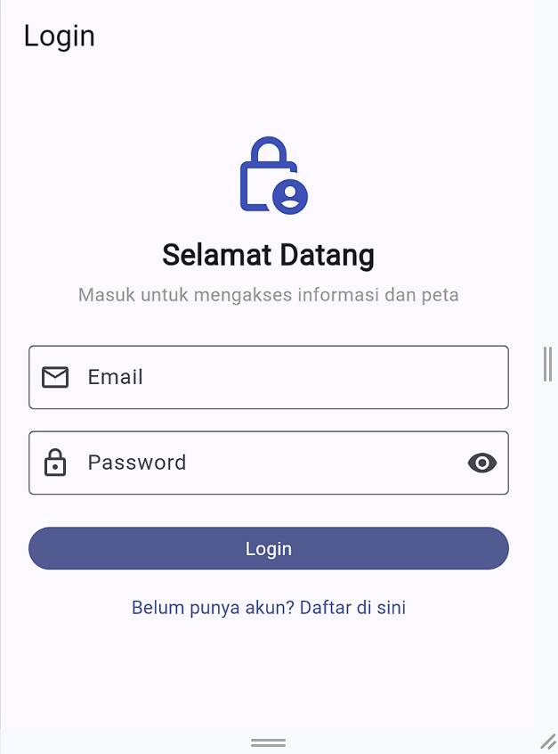
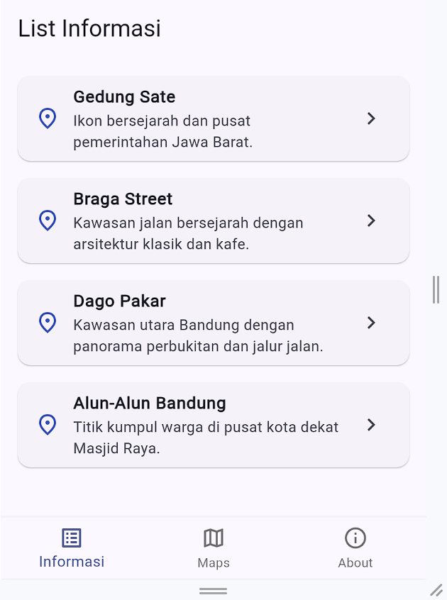
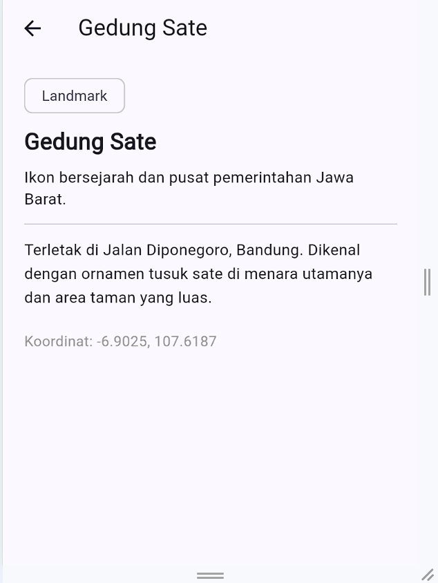
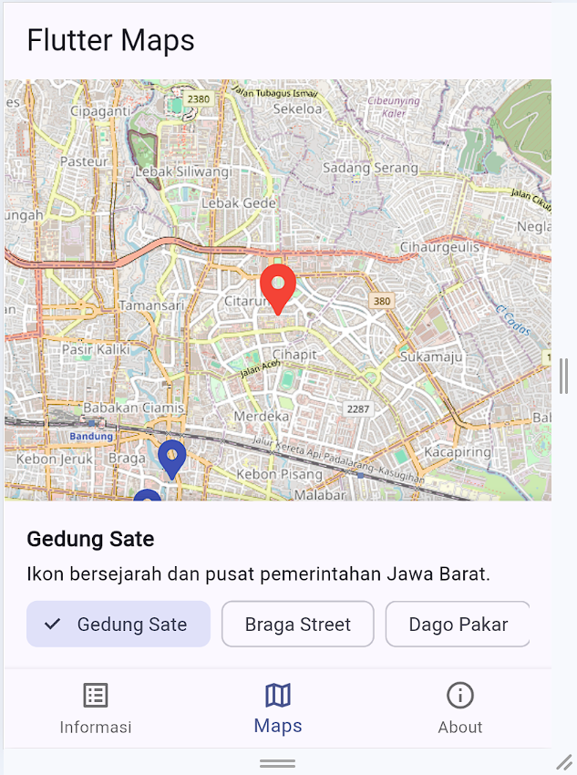
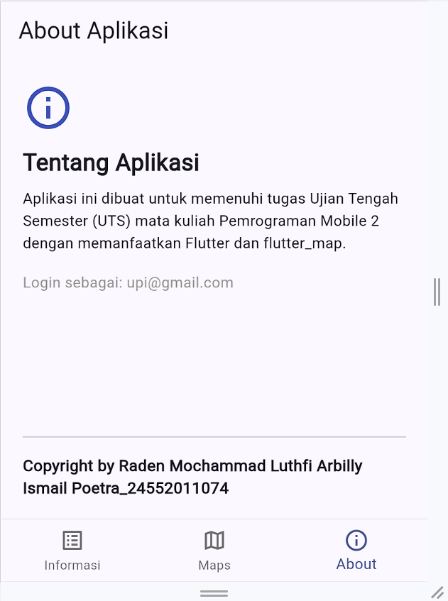

# UTS Pemrograman Mobile 2

Project aplikasi mobile berbasis Flutter untuk memenuhi tugas Ujian Tengah Semester (UTS) mata kuliah **Pemrograman Mobile 2** (3 SKS) di **Universitas Teknologi Bandung**.

## Identitas Mahasiswa & Mata Kuliah
- **Nama**: Raden Mochammad Luthfi Arbilly Ismail Poetra[cite: 7]
- **NPM**: 24552011074[cite: 7]
- **Kelas**: TIF RM 24 A[cite: 8]
- **Mata Kuliah**: Pemrograman Mobile 2 / 3 SKS[cite: 8]
- **Dosen Pengampu**: Nova Agustina, S.T., M.Kom.[cite: 8]

## Fitur Utama Aplikasi
- **SplashScreen**: Halaman pembuka sebelum masuk ke alur autentikasi[cite: 8].
- **Login & Register**: Halaman masuk dan pendaftaran akun pengguna dengan notifikasi status[cite: 3, 8].
- **Bottom Navigation**: Navigasi utama antara halaman **Informasi**, **Maps**, dan **About**[cite: 4, 6, 7, 8].
- **List & Detail Informasi**: Menampilkan daftar lokasi/informasi (seperti Gedung Sate, Braga Street, Dago Pakar, dan Alun-Alun Bandung) beserta detail dan koordinatnya[cite: 4, 5, 8].
- **Flutter Maps (`flutter_map` & `latlong2`)**: Menampilkan peta interaktif beserta *marker* lokasi dan pilihan titik lokasi[cite: 6, 8].
- **About Aplikasi**: Menampilkan informasi aplikasi, akun yang sedang login, serta *copyright* (`Copyright by Raden Mochammad Luthfi Arbilly Ismail Poetra_24552011074`)[cite: 7, 8].

## Cara Menjalankan Project
1. Pastikan Flutter SDK dan *dependencies* sudah terpasang:
   ```bash
   flutter pub get

   ## Dokumentasi Tampilan Aplikasi

### Halaman Login


### Halaman List Informasi


### Halaman Detail Informasi


### Halaman Flutter Maps


### Halaman About Aplikasi
